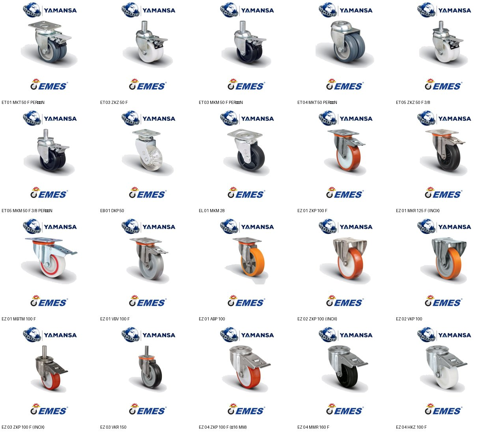
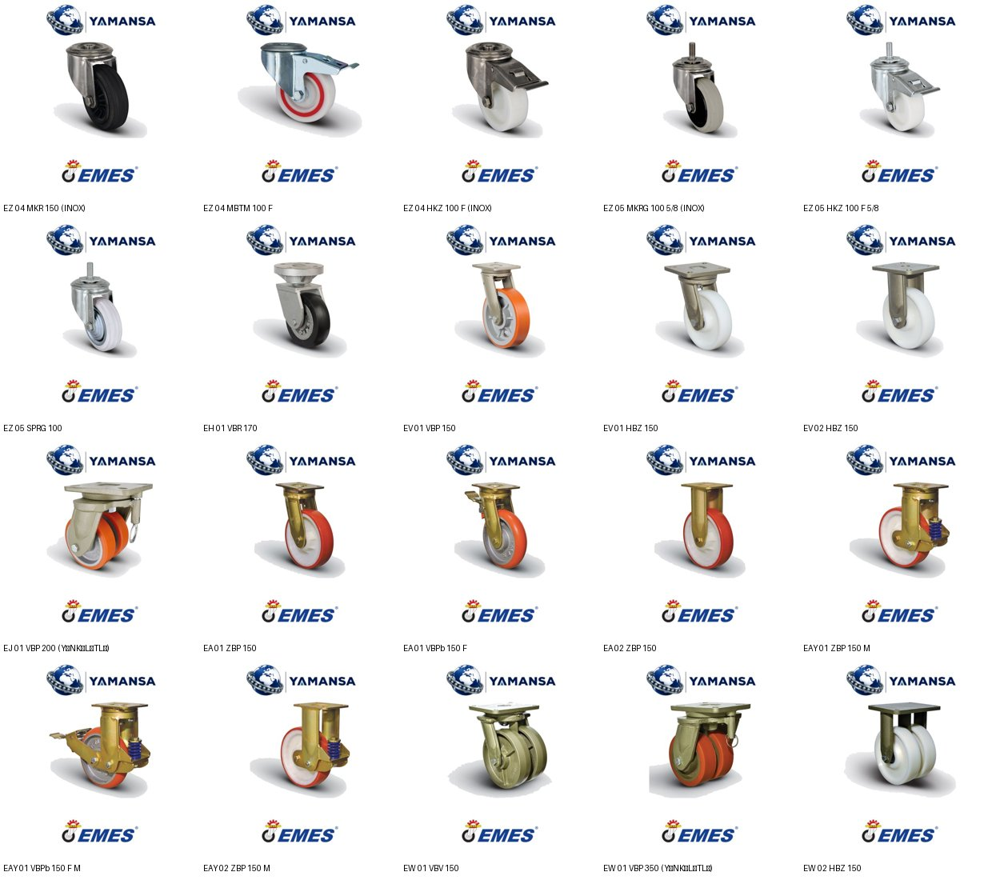

# Parça 03 – EMES TEKER

Toplam ürün: **2906**

## Görseller
- birebir: **642**
- ayni_tip: **357**
- resimsiz: **1907**
- farklı görsel dosyası: 275

| Ürün grubu | adet | birebir | ayni_tip | resimsiz |
|---|---|---|---|---|
| Komple teker | 1283 | 598 | 166 | 519 |
| Montaj borusu | 73 | 0 | 0 | 73 |
| Yedek teker | 415 | 44 | 191 | 180 |
| Teker maşası | 917 | 0 | 0 | 917 |
| Tamir/soket takımı | 218 | 0 | 0 | 218 |

Görsel kaynağı: emesteker.com resmi ürün sayfaları (arka plan beyaza çevrildi, Yamansa üst bant + EMES alt bant). Tüm farklı görseller tek tek kontak sayfalarında incelendi.
Resimsiz kalanlar: tekersiz maşalar, montaj boruları, tamir/soket takımları (üretici fotoğrafı yok) ve görünümü farklı olabilecek varyantlar (renk harfi M/K/S/Y, T/TF, perçin/civata, rulmansız, kapaklı, yön kilitli vb.). Yanlış görsel koymamak için boş bırakıldı.

## Kategori dağılımı (ana kategori)

| Kategori | adet |
|---|---|
| TEKERLEKLER>TEKER MAŞALARI | 917 |
| TEKERLEKLER>ORTA SANAYİ TİPİ TEKERLEKLER | 557 |
| TEKERLEKLER>EKSTRA AĞIR SANAYİ TİPİ TEKERLEKLER | 473 |
| TEKERLEKLER>YEDEK TEKERLER | 415 |
| TEKERLEKLER>TEKER YEDEK PARÇALARI VE AKSESUARLARI | 291 |
| TEKERLEKLER>SERVİS VE MOBİLYA TEKERLEKLERİ | 206 |
| TEKERLEKLER>AĞIR SANAYİ TİPİ TEKERLEKLER | 31 |
| TEKERLEKLER>HAFİF SANAYİ TİPİ TEKERLEKLER | 13 |
| TEKERLEKLER>DÖNER TEKERLEKLER | 2 |
| TEKERLEKLER>FRENLİ TEKERLEKLER | 1 |

Tüm atamalar (ürün birden çok kategoride olabilir):

| Kategori | adet |
|---|---|
| TEKERLEKLER | 2906 |
| TEKERLEKLER>DÖNER TEKERLEKLER | 1018 |
| TEKERLEKLER>TEKER MAŞALARI | 917 |
| TEKERLEKLER>ORTA SANAYİ TİPİ TEKERLEKLER | 557 |
| TEKERLEKLER>EKSTRA AĞIR SANAYİ TİPİ TEKERLEKLER | 473 |
| TEKERLEKLER>FRENLİ TEKERLEKLER | 423 |
| TEKERLEKLER>YEDEK TEKERLER | 415 |
| TEKERLEKLER>TEKER YEDEK PARÇALARI VE AKSESUARLARI | 291 |
| TEKERLEKLER>SABİT TEKERLEKLER | 260 |
| TEKERLEKLER>SERVİS VE MOBİLYA TEKERLEKLERİ | 206 |
| TEKERLEKLER>PASLANMAZ (INOX) TEKERLEKLER | 181 |
| TEKERLEKLER>AĞIR SANAYİ TİPİ TEKERLEKLER | 31 |
| TEKERLEKLER>HAFİF SANAYİ TİPİ TEKERLEKLER | 13 |

- Boş kategori: **0** 
- Bayraklı ürün: **2264**

Not: Girdi önerilerinden SEGMANLAR (3), GRES VE YAĞLAR (5), OTO RULMANLARI>DİĞER OTO RULMANLARI (8) yanlıştı (ürünler teker/maşa); düzeltildi. Kategori yapısı parça 01-02 ile ortak: ana kategori yük grubu (doğrulanabildiyse), sonra işlev kategorileri (döner/sabit/frenli/INOX/yedek/maşa/yedek parça), en sonda TEKERLEKLER. Yük grubu yalnız komple tekerlere uygulanır; yedek teker, maşa ve parçalarda ana kategori işlev kategorisidir. Bu parçada şişme teker/lastik yok.

## yeni_kategori_onerileri

| Kategori | adet | gerekçe |
|---|---|---|
| TEKERLEKLER>HAFİF SANAYİ TİPİ TEKERLEKLER | 13 | Üretici sitesinde (emesteker.com) bu adla ayrı bir teker grubu var; ürünler o gruba göre yerleştirildi |
| TEKERLEKLER>ORTA SANAYİ TİPİ TEKERLEKLER | 557 | Üretici sitesinde (emesteker.com) bu adla ayrı bir teker grubu var; ürünler o gruba göre yerleştirildi |
| TEKERLEKLER>AĞIR SANAYİ TİPİ TEKERLEKLER | 31 | Üretici sitesinde (emesteker.com) bu adla ayrı bir teker grubu var; ürünler o gruba göre yerleştirildi |
| TEKERLEKLER>EKSTRA AĞIR SANAYİ TİPİ TEKERLEKLER | 473 | Üretici sitesinde (emesteker.com) bu adla ayrı bir teker grubu var; ürünler o gruba göre yerleştirildi |
| TEKERLEKLER>SERVİS VE MOBİLYA TEKERLEKLERİ | 206 | Üretici sitesinde (emesteker.com) bu adla ayrı bir teker grubu var; ürünler o gruba göre yerleştirildi |
| TEKERLEKLER>DÖNER TEKERLEKLER | 1018 | Döner başlıklı tekerler (kod 01 veya üretici maşa tanımında döner) |
| TEKERLEKLER>SABİT TEKERLEKLER | 260 | Sabit maşalı tekerler (kod 02) |
| TEKERLEKLER>FRENLİ TEKERLEKLER | 423 | Frenli tekerler (kodda F) |
| TEKERLEKLER>PASLANMAZ (INOX) TEKERLEKLER | 181 | Paslanmaz (INOX) gövdeli tekerler |
| TEKERLEKLER>YEDEK TEKERLER | 415 | Maşasız satılan yedek tekerler; üretici sitesinde ayrı "Yedek Tekerler" grubu var |
| TEKERLEKLER>TEKER MAŞALARI | 917 | Tekersiz maşalar (kodda teker tipi yok); müşteriler maşayı ayrı arıyor |
| TEKERLEKLER>TEKER YEDEK PARÇALARI VE AKSESUARLARI | 291 | Teker montaj boruları, soket ve tamir takımları |

## Bayrak türleri

| Bayrak | adet |
|---|---|
| Üretici sitesinde bu kodun kendi sayfası yok; teknik bilgi ürün adındaki ölçülerle sınırlı | 1049 |
| Ürün tipi (tekersiz maşa) kod yapısından çıkarıldı; üretici sitesinde ayrı maşa sayfası yo | 917 |
| Görsel yok | 917 |
| Görsel bulunamadı (bu kod/varyant için üretici görseli yok) | 699 |
| Ürün adındaki ek ifade(ler) üretici kaynağında açıklanmıyor | 620 |
| Görsel aynı tip temsili | 357 |
| Görsel bulunamadı | 291 |
| Tamir takımının içeriği ve uyduğu modeller doğrulanamadı | 213 |
| Ölçülerin açılımı (çap/et/boy) ve kısaltmalar üretici kaynağında yok; adı tedarikçi tanımı | 73 |
| Döner/sabit olduğu üretici kaynağında doğrulanamadı | 5 |
| Soket ölçüsünün tam karşılığı (boru iç/dış ölçüsü) üretici kaynağında doğrulanamadı | 5 |
| Yük grubu (hafif/orta/ağır vb.) doğrulanamadı; ana kategori işlev kategorisi | 3 |
| Kod yapısı standart dışı; bağlantı tipi belirlenemedi | 1 |

## Örnek görseller

