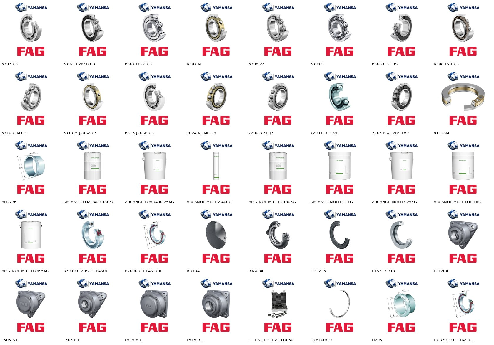
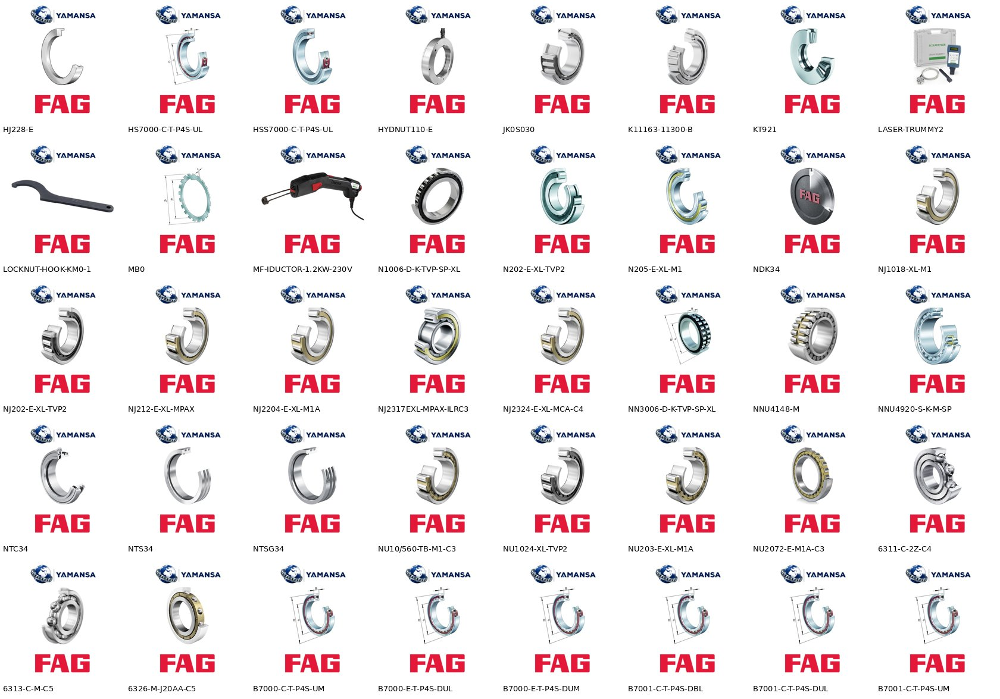

# Parça 5 – FAG ürünleri yayın hazırlığı
Toplam ürün: **3628** (girdi ile aynı sıra, tüm id'ler mevcut).
Teknik bilgiler ve görseller Schaeffler resmi ürün kayıtlarından (medias.schaeffler.com) alındı. Resmi kaydı bulunmayan kodlarda bilgi uydurulmadı; ilgili ürünler bayraklandı.
## Görsel durumu
- birebir (kodun kendi resmi görseli): **2130**
- ayni_tip (yalnız boşluk sınıfı / ön yük / takım farkı olan aynı rulmanın resmi görseli, FRM halkalarında aynı seri görseli): **902**
- resimsiz: **596**
- Farklı görsel dosyası: **71** (500x500 JPG, üstte Yamansa, altta FAG logosu)
Hariç tutulan resmi görseller: "image coming soon" yer tutucusu (FE halkaları), yalnız çizgi çizimi olan görseller (bazı HCS, HM, KM kodları), gri fonlu LASER-SMARTY2 fotoğrafı.
## Ana kategori dağılımı
| Kategori | Ürün |
|---|---|
| RULMAN>AÇISAL TEMASLI RULMANLAR | 1669 |
| RULMAN>SİLİNDİRİK MAKARALI RULMANLAR | 883 |
| RULMAN>SABİT BİLYALI RULMANLAR>TEK SIRALI SABİT BİLYALI RULMANLAR | 296 |
| RULMAN>MANŞON SOMUN VE PUL>MANŞON | 252 |
| RULMAN>RULMAN KEÇELERİ VE YATAK KEÇELERİ | 129 |
| RULMAN>RULMAN VE YATAK AKSESUARLARI | 114 |
| RULMAN>MANŞON SOMUN VE PUL>PUL | 69 |
| (boş) | 65 |
| RULMAN>MANŞON SOMUN VE PUL>SOMUN | 61 |
| RULMAN>YATAKLI RULMAN>RULMAN YATAKLARI VE INSERT | 57 |
| RULMAN>RULMAN MONTAJ VE BAKIM EKİPMANLARI | 14 |
| YAĞ VE BAKIM SPREYLERİ>GRESLER | 8 |
| RULMAN>KONİK MAKARALI RULMANLAR | 8 |
| RULMAN>EKSENEL MAKARALI VE İĞNELİ RULMANLAR | 3 |

## Tüm kategori atamaları (çoklu dahil)
| Kategori | Ürün |
|---|---|
| RULMAN>AÇISAL TEMASLI RULMANLAR | 1669 |
| RULMAN>SİLİNDİRİK MAKARALI RULMANLAR | 883 |
| RULMAN>SABİT BİLYALI RULMANLAR>TEK SIRALI SABİT BİLYALI RULMANLAR | 296 |
| RULMAN>MANŞON SOMUN VE PUL>MANŞON | 252 |
| RULMAN>RULMAN KEÇELERİ VE YATAK KEÇELERİ | 129 |
| RULMAN>RULMAN VE YATAK AKSESUARLARI | 114 |
| RULMAN>MANŞON SOMUN VE PUL>PUL | 69 |
| RULMAN>MANŞON SOMUN VE PUL>SOMUN | 61 |
| RULMAN>YATAKLI RULMAN>RULMAN YATAKLARI VE INSERT | 57 |
| RULMAN>SERAMİK RULMANLAR | 31 |
| RULMAN>RULMAN MONTAJ VE BAKIM EKİPMANLARI | 14 |
| YAĞ VE BAKIM SPREYLERİ>GRESLER | 8 |
| GRES VE YAĞLAR | 8 |
| RULMAN>KONİK MAKARALI RULMANLAR | 8 |
| RULMAN>MİNYATÜR RULMANLAR | 4 |
| RULMAN>EKSENEL MAKARALI VE İĞNELİ RULMANLAR | 3 |

- Boş kategori: **65**
- Bayraklı ürün: **1498**

## Bayrak türleri
| Bayrak | Ürün |
|---|---|
| Doğru ürün görseli bulunamadı | 596 |
| Takım | 390 |
| Bu kodun birebir resmi kaydı yok | 328 |
| Boşluk sınıfı farklı kaydın | 272 |
| Resmi üretici kaydı bulunamadı | 209 |
| Ürün tipi kod serisinden belirlendi | 82 |
| Kategori belirlenemedi | 65 |
| Ürün tipi tedarikçi kısa adından alındı | 62 |
| Tek rulman değerleri B7006-E-T-P4S-UL resmi kaydından alındı | 7 |
| Tek rulman değerleri B7008-E-T-P4S-UL resmi kaydından alındı | 6 |
| Tek rulman değerleri B7206-C-T-P4S-UL resmi kaydından alındı | 6 |
| Tek rulman değerleri B7211-E-T-P4S-UL resmi kaydından alındı | 6 |
| Tek rulman değerleri B7005-C-T-P4S-UL resmi kaydından alındı | 5 |
| Tek rulman değerleri B7006-C-T-P4S-UL resmi kaydından alındı | 5 |
| Tek rulman değerleri B7010-E-T-P4S-UL resmi kaydından alındı | 5 |
| Tek rulman değerleri B7011-C-T-P4S-UL resmi kaydından alındı | 5 |
| Tek rulman değerleri B7011-E-T-P4S-UL resmi kaydından alındı | 5 |
| Tek rulman değerleri B7013-C-T-P4S-UL resmi kaydından alındı | 5 |
| Tek rulman değerleri B7013-E-T-P4S-UL resmi kaydından alındı | 5 |
| Tek rulman değerleri B7014-C-T-P4S-UL resmi kaydından alındı | 5 |
| Tek rulman değerleri B7014-E-T-P4S-UL resmi kaydından alındı | 5 |
| Tek rulman değerleri B7015-C-T-P4S-UL resmi kaydından alındı | 5 |
| Tek rulman değerleri B7015-E-T-P4S-UL resmi kaydından alındı | 5 |
| Tek rulman değerleri B7016-E-T-P4S-UL resmi kaydından alındı | 5 |
| Tek rulman değerleri B7018-C-T-P4S-UL resmi kaydından alındı | 5 |
| Tek rulman değerleri B7018-E-T-P4S-UL resmi kaydından alındı | 5 |
| Tek rulman değerleri B71912-E-T-P4S-UL resmi kaydından alındı | 5 |
| Tek rulman değerleri B71916-E-T-P4S-UL resmi kaydından alındı | 5 |
| Tek rulman değerleri B71918-C-T-P4S-UL resmi kaydından alındı | 5 |
| Tek rulman değerleri B7205-C-T-P4S-UL resmi kaydından alındı | 5 |
| Tek rulman değerleri B7210-C-T-P4S-UL resmi kaydından alındı | 5 |
| Tek rulman değerleri B7210-E-T-P4S-UL resmi kaydından alındı | 5 |
| Tek rulman değerleri B7214-E-T-P4S-UL resmi kaydından alındı | 5 |
| Tek rulman değerleri B7216-C-T-P4S-UL resmi kaydından alındı | 5 |
| Tek rulman değerleri B7001-E-T-P4S-UL resmi kaydından alındı | 4 |
| Tek rulman değerleri B7003-C-T-P4S-UL resmi kaydından alındı | 4 |
| Tek rulman değerleri B7003-E-T-P4S-UL resmi kaydından alındı | 4 |
| Tek rulman değerleri B7004-C-T-P4S-UL resmi kaydından alındı | 4 |
| Tek rulman değerleri B7005-E-T-P4S-UL resmi kaydından alındı | 4 |
| Tek rulman değerleri B7007-E-T-P4S-UL resmi kaydından alındı | 4 |
| Tek rulman değerleri B7009-C-T-P4S-UL resmi kaydından alındı | 4 |
| Tek rulman değerleri B7010-C-T-P4S-UL resmi kaydından alındı | 4 |
| Tek rulman değerleri B7012-C-T-P4S-UL resmi kaydından alındı | 4 |
| Tek rulman değerleri B7012-E-T-P4S-UL resmi kaydından alındı | 4 |
| Tek rulman değerleri B7016-C-T-P4S-UL resmi kaydından alındı | 4 |
| Tek rulman değerleri B7017-C-T-P4S-UL resmi kaydından alındı | 4 |
| Tek rulman değerleri B7022-E-T-P4S-UL resmi kaydından alındı | 4 |
| Tek rulman değerleri B7032-E-T-P4S-UL resmi kaydından alındı | 4 |
| Tek rulman değerleri B71906-C-T-P4S-UL resmi kaydından alındı | 4 |
| Tek rulman değerleri B71906-E-T-P4S-UL resmi kaydından alındı | 4 |
| Tek rulman değerleri B71907-C-T-P4S-UL resmi kaydından alındı | 4 |
| Tek rulman değerleri B71907-E-T-P4S-UL resmi kaydından alındı | 4 |
| Tek rulman değerleri B71908-C-T-P4S-UL resmi kaydından alındı | 4 |
| Tek rulman değerleri B71908-E-T-P4S-UL resmi kaydından alındı | 4 |
| Tek rulman değerleri B71910-E-T-P4S-UL resmi kaydından alındı | 4 |
| Tek rulman değerleri B71912-C-T-P4S-UL resmi kaydından alındı | 4 |
| Tek rulman değerleri B71913-C-T-P4S-UL resmi kaydından alındı | 4 |
| Tek rulman değerleri B71914-C-T-P4S-UL resmi kaydından alındı | 4 |
| Tek rulman değerleri B71914-E-T-P4S-UL resmi kaydından alındı | 4 |
| Tek rulman değerleri B71915-C-T-P4S-UL resmi kaydından alındı | 4 |
| Tek rulman değerleri B71919-E-T-P4S-UL resmi kaydından alındı | 4 |
| Tek rulman değerleri B71920-E-T-P4S-UL resmi kaydından alındı | 4 |
| Tek rulman değerleri B71928-C-T-P4S-UL resmi kaydından alındı | 4 |
| Tek rulman değerleri B71930-C-T-P4S-UL resmi kaydından alındı | 4 |
| Tek rulman değerleri B71936-C-T-P4S-UL resmi kaydından alındı | 4 |
| Tek rulman değerleri B71938-C-T-P4S-UL resmi kaydından alındı | 4 |
| Tek rulman değerleri B7204-C-T-P4S-UL resmi kaydından alındı | 4 |
| Tek rulman değerleri B7207-C-T-P4S-UL resmi kaydından alındı | 4 |
| Tek rulman değerleri B7207-E-T-P4S-UL resmi kaydından alındı | 4 |
| Tek rulman değerleri B7208-C-T-P4S-UL resmi kaydından alındı | 4 |
| Tek rulman değerleri B7208-E-T-P4S-UL resmi kaydından alındı | 4 |
| Tek rulman değerleri B7209-E-T-P4S-UL resmi kaydından alındı | 4 |
| Tek rulman değerleri B7211-C-T-P4S-UL resmi kaydından alındı | 4 |
| Tek rulman değerleri B7212-C-T-P4S-UL resmi kaydından alındı | 4 |
| Tek rulman değerleri B7213-E-T-P4S-UL resmi kaydından alındı | 4 |
| Tek rulman değerleri B7215-C-T-P4S-UL resmi kaydından alındı | 4 |
| Tek rulman değerleri B7216-E-T-P4S-UL resmi kaydından alındı | 4 |
| Tek rulman değerleri B7001-C-T-P4S-UL resmi kaydından alındı | 3 |
| Tek rulman değerleri B7002-C-T-P4S-UL resmi kaydından alındı | 3 |
| Tek rulman değerleri B7004-E-T-P4S-UL resmi kaydından alındı | 3 |
| Tek rulman değerleri B7007-C-T-P4S-UL resmi kaydından alındı | 3 |
| Tek rulman değerleri B7008-C-T-P4S-UL resmi kaydından alındı | 3 |
| Tek rulman değerleri B7009-E-T-P4S-UL resmi kaydından alındı | 3 |
| Tek rulman değerleri B7017-E-T-P4S-UL resmi kaydından alındı | 3 |
| Tek rulman değerleri B7019-C-T-P4S-UL resmi kaydından alındı | 3 |
| Tek rulman değerleri B7020-C-T-P4S-UL resmi kaydından alındı | 3 |
| Tek rulman değerleri B7020-E-T-P4S-UL resmi kaydından alındı | 3 |
| Tek rulman değerleri B7022-C-T-P4S-UL resmi kaydından alındı | 3 |
| Tek rulman değerleri B7026-C-T-P4S-UL resmi kaydından alındı | 3 |
| Tek rulman değerleri B7026-E-T-P4S-UL resmi kaydından alındı | 3 |
| Tek rulman değerleri B7030-E-T-P4S-UL resmi kaydından alındı | 3 |
| Tek rulman değerleri B71900-E-T-P4S-UL resmi kaydından alındı | 3 |
| Tek rulman değerleri B71902-E-T-P4S-UL resmi kaydından alındı | 3 |
| Tek rulman değerleri B71903-E-T-P4S-UL resmi kaydından alındı | 3 |
| Tek rulman değerleri B71904-C-T-P4S-UL resmi kaydından alındı | 3 |
| Tek rulman değerleri B71904-E-T-P4S-UL resmi kaydından alındı | 3 |
| Tek rulman değerleri B71905-C-T-P4S-UL resmi kaydından alındı | 3 |
| Tek rulman değerleri B71905-E-T-P4S-UL resmi kaydından alındı | 3 |
| Tek rulman değerleri B71909-C-T-P4S-UL resmi kaydından alındı | 3 |
| Tek rulman değerleri B71909-E-T-P4S-UL resmi kaydından alındı | 3 |
| Tek rulman değerleri B71910-C-T-P4S-UL resmi kaydından alındı | 3 |
| Tek rulman değerleri B71911-E-T-P4S-UL resmi kaydından alındı | 3 |
| Tek rulman değerleri B71913-E-T-P4S-UL resmi kaydından alındı | 3 |
| Tek rulman değerleri B71916-C-T-P4S-UL resmi kaydından alındı | 3 |
| Tek rulman değerleri B71917-C-T-P4S-UL resmi kaydından alındı | 3 |
| Tek rulman değerleri B71917-E-T-P4S-UL resmi kaydından alındı | 3 |
| Tek rulman değerleri B71920-C-T-P4S-UL resmi kaydından alındı | 3 |
| Tek rulman değerleri B71922-E-T-P4S-UL resmi kaydından alındı | 3 |
| Tek rulman değerleri B71924-C-T-P4S-UL resmi kaydından alındı | 3 |
| Tek rulman değerleri B71926-C-T-P4S-UL resmi kaydından alındı | 3 |
| Tek rulman değerleri B71926-E-T-P4S-UL resmi kaydından alındı | 3 |
| Tek rulman değerleri B71930-E-T-P4S-UL resmi kaydından alındı | 3 |
| Tek rulman değerleri B71932-C-T-P4S-UL resmi kaydından alındı | 3 |
| Tek rulman değerleri B71932-E-T-P4S-UL resmi kaydından alındı | 3 |
| Tek rulman değerleri B71934-E-T-P4S-UL resmi kaydından alındı | 3 |
| Tek rulman değerleri B71936-E-T-P4S-UL resmi kaydından alındı | 3 |
| Tek rulman değerleri B71938-E-T-P4S-UL resmi kaydından alındı | 3 |
| Tek rulman değerleri B71940-E-T-P4S-UL resmi kaydından alındı | 3 |
| Tek rulman değerleri B71944-E-T-P4S-UL resmi kaydından alındı | 3 |
| Tek rulman değerleri B7202-E-T-P4S-UL resmi kaydından alındı | 3 |
| Tek rulman değerleri B7204-E-T-P4S-UL resmi kaydından alındı | 3 |
| Tek rulman değerleri B7205-E-T-P4S-UL resmi kaydından alındı | 3 |
| Tek rulman değerleri B7212-E-T-P4S-UL resmi kaydından alındı | 3 |
| Tek rulman değerleri B7214-C-T-P4S-UL resmi kaydından alındı | 3 |
| Tek rulman değerleri B7215-E-T-P4S-UL resmi kaydından alındı | 3 |
| Tek rulman değerleri B7218-E-T-P4S-UL resmi kaydından alındı | 3 |
| Tek rulman değerleri B7222-E-T-P4S-UL resmi kaydından alındı | 3 |
| Tek rulman değerleri HS71920-C-T-P4S-UL resmi kaydından alındı | 3 |
| Tek rulman değerleri B7000-C-T-P4S-UL resmi kaydından alındı | 2 |
| Tek rulman değerleri B7000-E-T-P4S-UL resmi kaydından alındı | 2 |
| Tek rulman değerleri B7002-E-T-P4S-UL resmi kaydından alındı | 2 |
| Tek rulman değerleri B7019-E-T-P4S-UL resmi kaydından alındı | 2 |
| Tek rulman değerleri B7021-C-T-P4S-UL resmi kaydından alındı | 2 |
| Tek rulman değerleri B7024-C-T-P4S-UL resmi kaydından alındı | 2 |
| Tek rulman değerleri B7024-E-T-P4S-UL resmi kaydından alındı | 2 |
| Tek rulman değerleri B7028-C-T-P4S-UL resmi kaydından alındı | 2 |
| Tek rulman değerleri B7028-E-T-P4S-UL resmi kaydından alındı | 2 |
| Tek rulman değerleri B7030-C-T-P4S-UL resmi kaydından alındı | 2 |
| Tek rulman değerleri B7034-C-T-P4S-UL resmi kaydından alındı | 2 |
| Tek rulman değerleri B7036-C-T-P4S-UL resmi kaydından alındı | 2 |
| Tek rulman değerleri B7036-E-T-P4S-UL resmi kaydından alındı | 2 |
| Tek rulman değerleri B71900-C-T-P4S-UL resmi kaydından alındı | 2 |
| Tek rulman değerleri B71901-C-T-P4S-UL resmi kaydından alındı | 2 |
| Tek rulman değerleri B71901-E-T-P4S-UL resmi kaydından alındı | 2 |
| Tek rulman değerleri B71902-C-T-P4S-UL resmi kaydından alındı | 2 |
| Tek rulman değerleri B71903-C-T-P4S-UL resmi kaydından alındı | 2 |
| Tek rulman değerleri B71911-C-T-P4S-UL resmi kaydından alındı | 2 |
| Tek rulman değerleri B71915-E-T-P4S-UL resmi kaydından alındı | 2 |
| Tek rulman değerleri B71918-E-T-P4S-UL resmi kaydından alındı | 2 |
| Tek rulman değerleri B71919-C-T-P4S-UL resmi kaydından alındı | 2 |
| Tek rulman değerleri B71922-C-T-P4S-UL resmi kaydından alındı | 2 |
| Tek rulman değerleri B71924-E-T-P4S-UL resmi kaydından alındı | 2 |
| Tek rulman değerleri B71934-C-T-P4S-UL resmi kaydından alındı | 2 |
| Tek rulman değerleri B71940-C-T-P4S-UL resmi kaydından alındı | 2 |
| Tek rulman değerleri B7200-E-T-P4S-UL resmi kaydından alındı | 2 |
| Tek rulman değerleri B7203-C-T-P4S-UL resmi kaydından alındı | 2 |
| Tek rulman değerleri B7203-E-T-P4S-UL resmi kaydından alındı | 2 |
| Tek rulman değerleri B7206-E-T-P4S-UL resmi kaydından alındı | 2 |
| Tek rulman değerleri B7209-C-T-P4S-UL resmi kaydından alındı | 2 |
| Tek rulman değerleri B7213-C-T-P4S-UL resmi kaydından alındı | 2 |
| Tek rulman değerleri B7217-C-T-P4S-UL resmi kaydından alındı | 2 |
| Tek rulman değerleri B7217-E-T-P4S-UL resmi kaydından alındı | 2 |
| Tek rulman değerleri B7218-C-T-P4S-UL resmi kaydından alındı | 2 |
| Tek rulman değerleri B7219-C-T-P4S-UL resmi kaydından alındı | 2 |
| Tek rulman değerleri B7220-C-T-P4S-UL resmi kaydından alındı | 2 |
| Tek rulman değerleri B7220-E-T-P4S-UL resmi kaydından alındı | 2 |
| Tek rulman değerleri B7222-C-T-P4S-UL resmi kaydından alındı | 2 |
| Tek rulman değerleri B7224-C-T-P4S-UL resmi kaydından alındı | 2 |
| Tek rulman değerleri B7224-E-T-P4S-UL resmi kaydından alındı | 2 |
| Tek rulman değerleri B7226-E-T-P4S-UL resmi kaydından alındı | 2 |
| Tedarikçi notunda araç uyumu var | 2 |
| Tek rulman değerleri HS7009-C-T-P4S-UL resmi kaydından alındı | 2 |
| Tek rulman değerleri HS7009-E-T-P4S-UL resmi kaydından alındı | 2 |
| Tek rulman değerleri HS7011-C-T-P4S-UL resmi kaydından alındı | 2 |
| Tek rulman değerleri HS71914-E-T-P4S-UL resmi kaydından alındı | 2 |
| Tek rulman değerleri HS71916-E-T-P4S-UL resmi kaydından alındı | 2 |
| Tek rulman değerleri HS71917-E-T-P4S-UL resmi kaydından alındı | 2 |
| Tek rulman değerleri HS71920-E-T-P4S-UL resmi kaydından alındı | 2 |
| Tek rulman değerleri B7021-E-T-P4S-UL resmi kaydından alındı | 1 |
| Tek rulman değerleri B7032-C-T-P4S-UL resmi kaydından alındı | 1 |
| Tek rulman değerleri B7034-E-T-P4S-UL resmi kaydından alındı | 1 |
| Tek rulman değerleri B71903-E-2RSD-T-P4S-UL resmi kaydından alındı | 1 |
| Tek rulman değerleri B71904-C-2RSD-T-P4S-UL resmi kaydından alındı | 1 |
| Tek rulman değerleri B71916-E-2RSD-T-P4S-UL resmi kaydından alındı | 1 |
| Tek rulman değerleri B71921-C-T-P4S-UL resmi kaydından alındı | 1 |
| Tek rulman değerleri B71921-E-T-P4S-UL resmi kaydından alındı | 1 |
| Tek rulman değerleri B71928-E-T-P4S-UL resmi kaydından alındı | 1 |
| Tek rulman değerleri B71944-C-T-P4S-UL resmi kaydından alındı | 1 |
| Tek rulman değerleri B71948-E-T-P4S-UL resmi kaydından alındı | 1 |
| Tek rulman değerleri B7200-C-T-P4S-UL resmi kaydından alındı | 1 |
| Tek rulman değerleri B7201-C-T-P4S-UL resmi kaydından alındı | 1 |
| Tek rulman değerleri B7201-E-T-P4S-UL resmi kaydından alındı | 1 |
| Tek rulman değerleri B7202-C-T-P4S-UL resmi kaydından alındı | 1 |
| Tek rulman değerleri B7219-E-T-P4S-UL resmi kaydından alındı | 1 |
| Tek rulman değerleri B7226-C-T-P4S-UL resmi kaydından alındı | 1 |
| Tek rulman değerleri HCS7016-E-T-P4S-UL resmi kaydından alındı | 1 |
| Tek rulman değerleri HS7001-C-T-P4S-UL resmi kaydından alındı | 1 |
| Tek rulman değerleri HS7002-C-T-P4S-UL resmi kaydından alındı | 1 |
| Tek rulman değerleri HS7004-C-T-P4S-UL resmi kaydından alındı | 1 |
| Tek rulman değerleri HS7005-C-T-P4S-UL resmi kaydından alındı | 1 |
| Tek rulman değerleri HS7006-C-T-P4S-UL resmi kaydından alındı | 1 |
| Tek rulman değerleri HS7007-C-T-P4S-UL resmi kaydından alındı | 1 |
| Tek rulman değerleri HS7010-C-T-P4S-UL resmi kaydından alındı | 1 |
| Tek rulman değerleri HS7012-C-T-P4S-UL resmi kaydından alındı | 1 |
| Tek rulman değerleri HS7013-C-T-P4S-UL resmi kaydından alındı | 1 |
| Tek rulman değerleri HS7014-C-T-P4S-UL resmi kaydından alındı | 1 |
| Tek rulman değerleri HS7014-E-T-P4S-UL resmi kaydından alındı | 1 |
| Tek rulman değerleri HS7016-C-T-P4S-UL resmi kaydından alındı | 1 |
| Tek rulman değerleri HS7016-E-T-P4S-UL resmi kaydından alındı | 1 |
| Tek rulman değerleri HS7018-C-T-P4S-UL resmi kaydından alındı | 1 |
| Tek rulman değerleri HS7018-E-T-P4S-UL resmi kaydından alındı | 1 |
| Tek rulman değerleri HS7022-E-T-P4S-UL resmi kaydından alındı | 1 |
| Tek rulman değerleri HS7026-E-T-P4S-UL resmi kaydından alındı | 1 |
| Tek rulman değerleri HS71903-E-T-P4S-UL resmi kaydından alındı | 1 |
| Tek rulman değerleri HS71908-C-T-P4S-UL resmi kaydından alındı | 1 |
| Tek rulman değerleri HS71909-E-T-P4S-UL resmi kaydından alındı | 1 |
| Tek rulman değerleri HS71910-C-T-P4S-UL resmi kaydından alındı | 1 |
| Tek rulman değerleri HS71910-E-T-P4S-UL resmi kaydından alındı | 1 |
| Tek rulman değerleri HS71911-E-T-P4S-UL resmi kaydından alındı | 1 |
| Tek rulman değerleri HS71912-C-T-P4S-UL resmi kaydından alındı | 1 |
| Tek rulman değerleri HS71912-E-T-P4S-UL resmi kaydından alındı | 1 |
| Tek rulman değerleri HS71913-C-T-P4S-UL resmi kaydından alındı | 1 |
| Tek rulman değerleri HS71913-E-T-P4S-UL resmi kaydından alındı | 1 |
| Tek rulman değerleri HS71914-C-T-P4S-UL resmi kaydından alındı | 1 |
| Tek rulman değerleri HS71922-E-T-P4S-UL resmi kaydından alındı | 1 |
| Tek rulman değerleri HS71926-E-T-P4S-UL resmi kaydından alındı | 1 |

## yeni_kategori_onerileri
- `RULMAN>RULMAN MONTAJ VE BAKIM EKİPMANLARI` — 14 ürün. Rulman ısıtıcı, indüktör, çakma seti, somun anahtarı, hidrolik somun, lazer hizalama/kayış gerginlik cihazı ve otomatik yağlayıcı gibi montaj-bakım ürünleri için mevcut ağaçta uygun kategori yok.
- `RULMAN>RULMAN VE YATAK AKSESUARLARI` — 114 ürün. Rulman yatağı sabitleme halkaları (FRM/FE), yatak kapakları (BDK/NDK) ve silindirik makaralı rulman L halkaları (HJ) rulman veya keçe değil; mevcut ağaçta karşılığı yok.

## Notlar
- Kodun sonundaki C2/C3/C4/C5 (iç boşluk), UL/UM/UH (ön yük) ve DUL/DBL/TBT gibi takım ekleri ürünü değiştirdiği için hiçbir ürün birleştirilmedi; her stok kodu ayrı kaldı. Bu eklerin farkı yalnız ölçü/yük değerinin ve görselin aynı temel rulmandan alınmasında kullanıldı ve bayrakta belirtildi.
- Resmi kaydı olmayan ama aynı seri numaralı rulmanı olan kodlarda yalnız d/D/B ana ölçüleri yazıldı; kafes, yük ve görsel yazılmadı.
- Tedarikçi notlarındaki muadil kodlar ve araç uyumları doğrulanamadığı için müşteri metnine yazılmadı.
- Arcanol gresler hem mevcut `YAĞ VE BAKIM SPREYLERİ>GRESLER` hem de yeni `GRES VE YAĞLAR` kategorisine kondu.
- Kontrol: `python3 rd/parca-05/kontrol.py parca_05.jsonl kategoriler.txt`

## Örnek görseller

