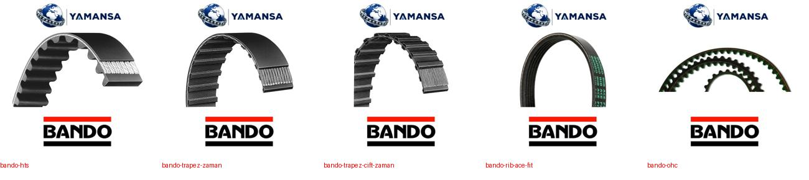
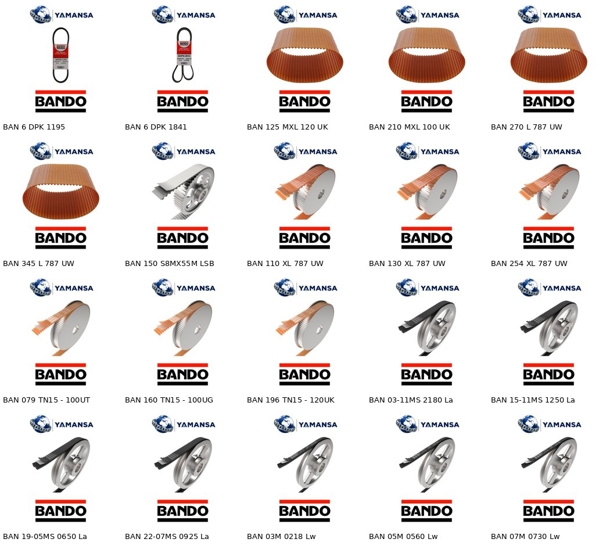
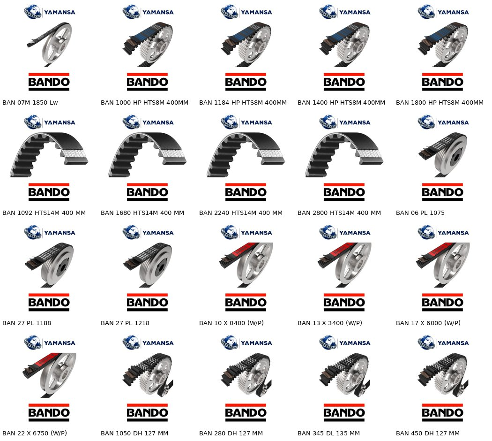

# Parça 08 – BANDO raporu

Toplam ürün: **2977** (girişteki tüm id'ler aynı sırada, stok kodları değişmeden).

## Görsel
- Birebir (koda özel fotoğraf): **2** – Bando sitesinde koda özel fotoğraf yok, sadece seri fotoğrafları var.
- Aynı tip / aynı seri fotoğraf: **2968**
- Resimsiz (doğru görsel bulunamadı): **2**

Kullanılan görseller (hepsi bando.de resmi ürün fotoğraflarından, Yamansa şablonu + Bando logosu):

| Dosya | Ürün sayısı |
|---|---|
| bando-rib-ace-pk.jpg | 1323 |
| bando-klasik-v-kayisi.jpg | 818 |
| bando-rpf.jpg | 311 |
| bando-trapez-zaman.jpg | 162 |
| bando-banflex-scrum.jpg | 109 |
| bando-banflex.jpg | 97 |
| bando-neopren-zaman.jpg | 33 |
| bando-hp-hts-8m.jpg | 32 |
| bando-neopren-cift-zaman.jpg | 32 |
| bando-hts.jpg | 26 |
| bando-bancollan-genel.jpg | 12 |
| bando-ohc-kesit.jpg | 5 |
| bando-kanalli-pl.jpg | 3 |
| bando-bancollan-tn.jpg | 3 |
| bando-bancollan-pu-zaman.jpg | 3 |
| bando-trapez-cift-zaman.jpg | 3 |
| bando-bancollan-lsb.jpg | 1 |
| bando-6dpk1195.jpg | 1 |
| bando-6dpk1841.jpg | 1 |

## Görsel tur 2
Önce: birebir 0 / ayni_tip 2896 / kesit 0 / yok 81. Sonra: birebir 0 / ayni_tip 2973 / kesit 0 / yok 4.
Yeni görseller bando.de ve bandousa.com resmi ürün fotoğraflarından: HTS (26), MXL/DXL …G (43), OHC (5), 4 PK 0970F Rib Ace Fit (1), L/TN15 UG (2). Bkz. ornek_tur2.jpg

Hâlâ resimsiz: 6 DPK 1195/1841/2290 (Bando sitelerinde çift taraflı kanallı kayış fotoğrafı yok; altıgen çift V kayışı farklı ürün), 268 SL 400 MM (SL profili Bando sayfalarında bulunamadı).

## Görsel tur 3 (derin arama + yazı/kadraj denetimi)
Önce: birebir 0 / ayni_tip 2973 / kesit 0 / yok 4. Sonra: birebir 2 / ayni_tip 2968 / kesit 5 / yok 2.
Birebir: 6 DPK 1195 ve 6 DPK 1841, Bando ABD ambalajında kendi kodu okunan temiz ürün fotoğrafı.
Denetimde düzeltilen (946 ürün, 4 görsel): W/P 818 ürün eski görselde "A-" kesit harfi okunuyordu, Bando Power Ace (kodsuz baskı) fotoğrafına geçildi; XL 90 + H 32 ürün eski görselde "L" profil yazısı okunuyordu, yazısız Bando neopren trapez dişli kayışa geçildi; OHC 5 ürün kayış kutudan çıktığı için kadraj dışına taşıyordu, Bando resmi oto triger kesit render’ı kondu (kesit); 4 PK 0970F kayış kadraj dışına taşıyordu ve ambalajda başka kod vardı, Rib Ace PK görseline geçildi.
Tur 4: 6 DPK 2290 için kodu okunmayan Bando DPK fotoğrafı arandı; eBay sonuçlarında yalnız 6DPK1195/1841 ambalajlı fotoğrafları ve başka marka (D&D PowerDrive) kayışlar çıktı, bandousa.com oto sayfasında DPK yok. 268 SL için Bando JP (bandogrp.com, monotaro, misumi) arandı; oradaki SL kodları Sunline konveyör bantları, farklı ürün. W/P: Power Ace kumaş kaplı (W/P ile aynı yapı) ama dar kesit; W/P genişlikleri (10/13/17/22/32) klasik kesit. Klasik kesitli Bando fotoğraflarında (red marking, RED-S II, W800) "A-"/"SA-" kodu okunduğu için kullanılamıyor; Power Ace kaldı, bayrak güncellendi.
Tur 5: W/P 818 ürün Power Ace (dar SP kesit) yerine Bando kumaş kaplı klasik V kayışı görseline geçti (bando.de red-marking, kesit harfi ve uzunluk okunmayacak şekilde kadrajlı; parça 09 ile aynı kaynak). Genişliğe göre: 10 mm 28, 12,5 mm 85, 13 mm 139, 17 mm 216, 22 mm 194, 25 mm 49, 32 mm 107 ürün, hepsi aynı görsel (görselde harf olmadığı için kesitle çelişmiyor). Bancollan PU MXL 4 + L 8 ürün Bando Türkiye resmi Bancollan fotoğrafına geçti; XL 3 ürün bando.de XL PU görselinde kaldı. Örnek: ornek_wp.jpg.
Hâlâ resimsiz: 6 DPK 2290 (Bando kodlu fotoğraf bulunamadı; bulunan DK060901 görseli başka marka ambalajında), 268 SL 400 MM (268SL dikiş makinesi triger kayışı kodu; Bando ürün fotoğrafı yok, mağaza görselleri logolu).
Denenen kaynaklar: bando.de (tüm ürün/sayfa site haritası görselleri), bandousa.com, products.bandogrp.com (bakımda), bandogrp.com PDF, eBay, Amazon, NAPA, FinditParts, Texas Belting (genel seri görseli), autopartsandstuff, RockAuto, Autodoc, newparts, beltpalace, diamondneedle/jacksew, DuckDuckGo/Bing.

## Kategori dağılımı

| Kategori | Ürün |
|---|---|
| KAYIŞ>KANALLI V KAYIŞI | 1329 |
| KAYIŞ>DÜZ V KAYIŞI | 818 |
| KAYIŞ>TRIGER KAYIŞI | 313 |
| KAYIŞ>TIRTILLI V KAYIŞI | 311 |
| KAYIŞ>BANFLEX ZAMAN KAYIŞI | 206 |

Boş kategori: **0**

Notlar:
- Banflex ve Banflex Scrum aslında poliüretan **V kayışıdır** (zaman kayışı değil); sitede hazır olan "KAYIŞ>BANFLEX ZAMAN KAYIŞI" kategorisine kondu. Kategori adının "BANFLEX V KAYIŞI" olarak düzeltilmesi önerilir.
- Önerilen "KAYIŞ>ZAMAN KAYIŞLARI" yerine sitede zaten var olan "KAYIŞ>TRIGER KAYIŞI" kullanıldı (aynı ürün grubu).
- 4 PK…, 6 DPK…, PL ürünleri "KAYIŞ>KANALLI V KAYIŞI"na kondu.

## yeni_kategori_onerileri

Yok – tüm ürünler mevcut kategorilere yerleşti.

## Bayraklar (1160 ürün bayraklı)

| Adet | Not |
|---|---|
| 818 | W/P yapısı üretici sayfasında ayrıca anlatılmıyor; görsel Bando kumaş kaplı klasik V kayışından (aynı tip); görselde kesit harfi ve uzunluk okunmuyor |
| 213 | koddaki "400 MM" ölçüsünün ne olduğu (genişlik/manşon) doğrulanamadı |
| 122 | görsel Bando neopren trapez dişli kayıştan (aynı profil tipi, farklı ölçü) |
| 43 | malzeme doğrulanamadı; görsel Bando neopren trapez dişli kayıştan (aynı profil tipi) |
| 39 | koddaki "191G" ifadesinin anlamı doğrulanamadı |
| 26 | görsel Bando HT (HTD yuvarlak diş) serisi kayıştan, aynı tip |
| 24 | referans/OEM numaraları ve araç uyumu üreticiden kontrol edilmedi |
| 22 | koddaki "127 MM" ölçüsünün ne olduğu (genişlik/manşon) doğrulanamadı |
| 11 | koddaki "787" ölçüsü çevrilmedi/doğrulanmadı |
| 11 | görsel aynı seri XL profil Bancollan kayıştan |
| 10 | koddaki "135 MM" ölçüsünün ne olduğu (genişlik/manşon) doğrulanamadı |
| 5 | diş sayısı ve genişlik koddan çözülmedi, doğrulanmadı |
| 5 | görsel Bando oto triger kayışının resmi kesit çiziminden (3B render), ürünün kendisi değil |
| 3 | ürün adı boş geldi; kod yapısı (…M … Lw) Banflex serisiyle aynı olduğu için Banflex olarak eşlendi, kontrol edin |
| 3 | koddaki "100" ölçüsü çevrilmedi/doğrulanmadı |
| 3 | koddaki "500G" ifadesinin anlamı doğrulanamadı |
| 3 | DPK yapısı (çift taraflı kanal) üretici sayfasında doğrulanamadı |
| 1 | koddaki "079" ve "100" değerlerinin karşılığı (uzunluk/genişlik) doğrulanamadı |
| 1 | koddaki "120" ölçüsü çevrilmedi/doğrulanmadı |
| 1 | koddaki "120G" ifadesinin anlamı doğrulanamadı |
| 1 | koddaki 55 m uzunluk, üreticinin S8M için verdiği en fazla 30 m rulo boyuyla uyuşmuyor; uzunluk yazılmadı |
| 1 | koddaki "160" ve "100" değerlerinin karşılığı (uzunluk/genişlik) doğrulanamadı |
| 1 | UG ekinin anlamı TN tablosunda yok |
| 1 | görsel aynı seri TN kayıştan, halat tipi farklı olabilir |
| 1 | koddaki "196" ve "120" değerlerinin karşılığı (uzunluk/genişlik) doğrulanamadı |
| 1 | UG ekinin (halat tipi) anlamı doğrulanamadı |
| 1 | görsel Bancollan PU zaman kayışından, halat tipi farklı olabilir |
| 1 | SL profili Bando sayfalarında bulunamadı; profil ölçüleri yazılmadı |
| 1 | 400 MM ölçüsü doğrulanamadı |
| 1 | görsel eklenmedi |
| 1 | F eki Bando Rib Ace Fit serisinde kullanılıyor; görsel Bando Rib Ace PK kayıştan (aynı kanal yapısı) |
| 1 | birebir/aynı tip görsel bulunamadı |
| 1 | notta başka marka/stok bilgisi vardı, kullanılmadı |

## Kaynaklar
- Teknik değerler: bando.de resmi ürün sayfaları (her üründe `teknik_kaynak` alanında), ürün kodunun kendisi (kanal sayısı, genişlik, uzunluk) ve ürün notları (HP-HTS uzunlukları, referans numaraları, LSB genişliği).
- Koddan çözülemeyen değerler (ör. "400 MM", "787", "191G") teknik tabloya yazılmadı, bayrak olarak işaretlendi.

## Örnek görseller

