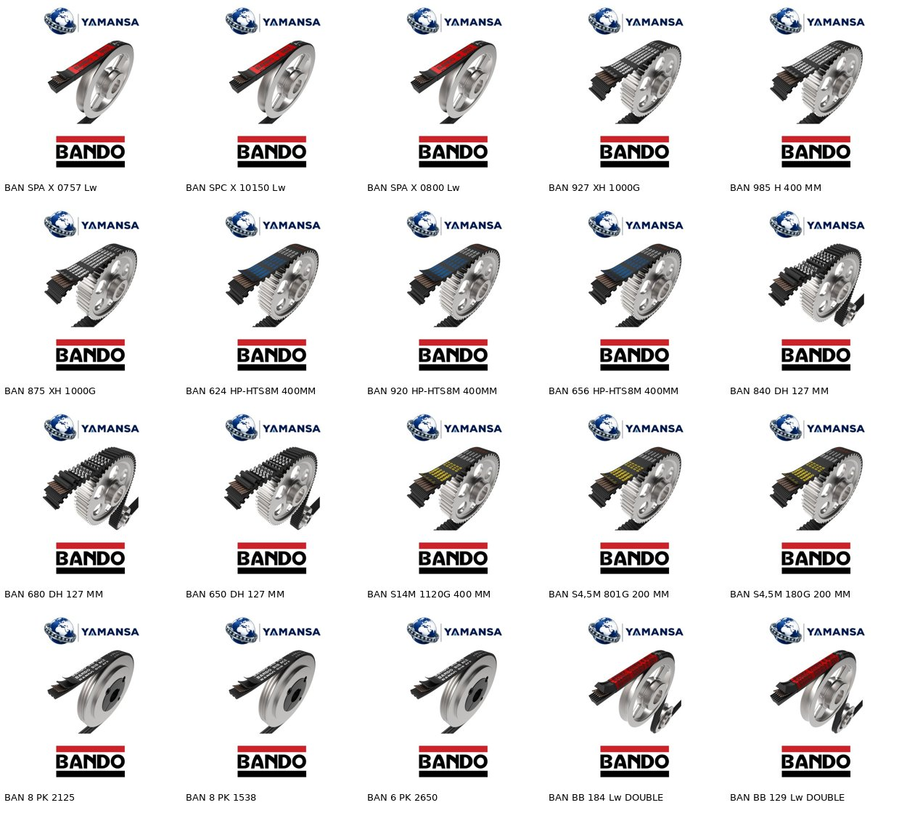
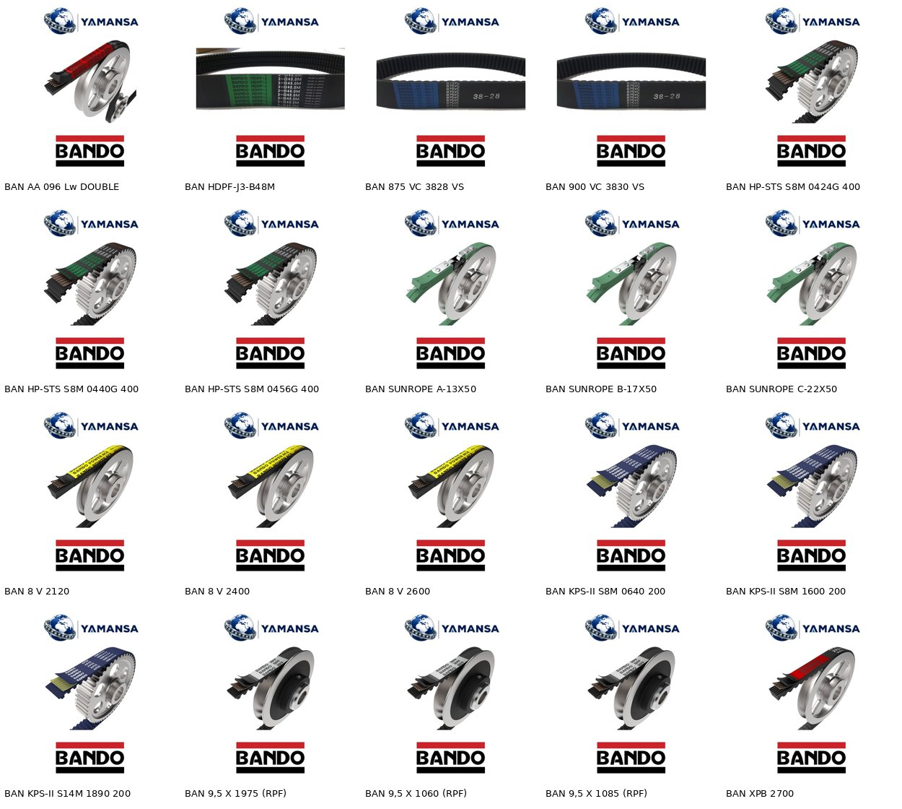

# Parça 09 – BANDO raporu

Toplam ürün: **2977** (tamamı BANDO markası)

## Görsel durumu

- birebir: 2
- ayni_tip: 2225
- resimsiz: 750
- farklı görsel dosyası: 15

Aynı tip görseller Bando Avrupa resmi sitesindeki seri fotoğraflarıdır (kayış profili/yapısı ürünle aynı). Birebir görseller kodun kendisinin göründüğü temiz ürün fotoğraflarıdır.

### Resimsiz ürünler (neden)

- Poliüretan T/DT zaman kayışı: 270
- STS / çift dişli STS (DS, S1,5M-S3M): 201
- (W/P) düz V kayışı: 154
- HP-STS S5M: 94
- XS8M Ceptor: 9
- Bancord yuvarlak: 6
- DPK kanallı: 4
- Sunrope kilit: 4
- XL UW: 3
- Smooth Coupler alternatör kasnağı: 2
- HDPF-J2: 2
- Gergi ölçer: 1

Bu gruplarda renk/görünüş ya da tip üretici kaynağında doğrulanamadığı için yanlış görsel koymak yerine boş bırakıldı.

## Kategori dağılımı (tüm atamalar)

- KAYIŞ>DAR V KAYIŞI (SPZ-SPA-SPB-SPC): 1141
- KAYIŞ>KANALLI V KAYIŞI: 785
- KAYIŞ>ZAMAN KAYIŞLARI: 765
- KAYIŞ>TIRTILLI V KAYIŞI: 413
- KAYIŞ>DÜZ V KAYIŞI: 163
- KAYIŞ>ÖZEL KAYIŞLAR: 24
- KAYIŞ>YUVARLAK KAYIŞ: 6
- KAYIŞ>KAYIŞ AKSESUARLARI: 5
- KASNAKLAR>ALTERNATÖR KASNAKLARI: 2

### Ana kategori

- KAYIŞ>DAR V KAYIŞI (SPZ-SPA-SPB-SPC): 1141
- KAYIŞ>KANALLI V KAYIŞI: 785
- KAYIŞ>ZAMAN KAYIŞLARI: 765
- KAYIŞ>DÜZ V KAYIŞI: 163
- KAYIŞ>TIRTILLI V KAYIŞI: 86
- KAYIŞ>ÖZEL KAYIŞLAR: 24
- KAYIŞ>YUVARLAK KAYIŞ: 6
- KAYIŞ>KAYIŞ AKSESUARLARI: 5
- KASNAKLAR>ALTERNATÖR KASNAKLARI: 2

Boş kategori: **0**

Bayraklı ürün: **1041**

### Bayrak türleri

- Koddaki … değerinin kayış genişliği mi kovan (manşon) genişliği mi olduğu üretici kaynağında doğrulanamadı (760)
- Koddaki … harflerinin (halat tipi) bu kayış için karşılığı üretici kaynağında doğrulanamadı (270)
- Renk ve görünüş doğrulanamadığı için görsel konmadı (270)
- Ölçü kodundaki … ve … değerlerinin hangi ölçüyü (üst genişlik / uzunluk türü) gösterdiği üretici kaynağında doğrulanamadı (240)
- (W/P) tipinin görünüşü doğrulanamadığı için görsel konmadı (154)
- Çift dişli STS için uygun üretici fotoğrafı bulunamadı; görsel konmadı (102)
- S…M tipte temiz kumaş kullanıldığı için görünüşü farklı olabilir; görsel konmadı (99)
- HP-S…M sadece temiz (clean) tip üretildiği için görünüşü farklı olabilir; görsel konmadı (94)
- …V profil SP serisinde olmadığı için DÜZ V KAYIŞI kategorisine kondu; kategori onayı iyi olur (9)
- XS…M kodlu Ceptor serisi üretici kaynağında doğrulanamadı; teknik bilgiler sınırlı tutuldu (9)
- Görünüş doğrulanamadığı için görsel konmadı (9)
- Bancord için uygun üretici ürün fotoğrafı bulunamadı; görsel konmadı (6)
- Etkin uzunluk üretici tablosunda bulunamadı (5)
- Bu uzunluk üretici ölçü tablosunda bulunamadı (5)
- KAYIŞ>KAYIŞ AKSESUARLARI yeni kategori önerisi (5)
- DPK kodunun (çift taraflı olup olmadığı) üretici kaynağında doğrulanamadı; görsel konmadı (4)
- Bağlantı elemanının üretici fotoğrafı bulunamadı; görsel konmadı (4)
- Koddaki … ibaresinin anlamı ve kayışın malzemesi doğrulanamadı; görsel konmadı (3)
- Dış uzunluk üretici tablosunda bulunamadı (3)
- HDPF-J serisi üretici sitesinde bulunamadı; ölçüler tedarikçi notundan alındı (3)
- Koddaki … ve …-… değerlerinin hangi ölçüleri gösterdiği üretici kaynağında doğrulanamadı (2)
- Koddaki … ibaresinin anlamı doğrulanamadı; tedarikçi tanımında genişlik … mm yazıyor (2)
- Tedarikçi notunda farklı ölçü yazıyor (… X …); stok kodu ile not birbirini tutmuyor, kontrol edilmeli (2)
- Bu modelin üretici fotoğrafı bulunamadı; görsel konmadı (2)
- KASNAKLAR>ALTERNATÖR KASNAKLARI yeni kategori önerisi (2)
- … sıralı tip için fotoğraf yok; görsel konmadı (2)
- Görsel, aynı seri …VC kayışın fotoğrafıdır (1)
- Gergi ölçerin modeli ve teknik özellikleri üretici kaynağında doğrulanamadı; görsel konmadı (1)

## yeni_kategori_onerileri

- **KAYIŞ>KAYIŞ AKSESUARLARI** – 5 ürün. Sunrope kayış kilitleri (bağlantı elemanı) ve kayış gergi ölçer kayış değildir; mevcut KAYIŞ alt kategorilerine uymuyor.
- **KASNAKLAR>ALTERNATÖR KASNAKLARI** – 2 ürün. Bando Smooth Coupler tek yönlü kavramalı alternatör kasnakları; KASNAKLAR altındaki V kasnak / burç kategorilerine uymuyor.

## Kategori notları

- XPZ/XPA/XPB (yanakları açık dişli dar V) hem DAR V KAYIŞI hem TIRTILLI V KAYIŞI kategorisine kondu.
- Variatör (VS) kayışları ÖZEL KAYIŞLAR + TIRTILLI V KAYIŞI; HDPF-J3 (fotoğrafta dişli görünüyor) ÖZEL + TIRTILLI, HDPF-J2 sadece ÖZEL.
- 8V Power Ace, SP serisi olmadığı için DÜZ V KAYIŞI kategorisine kondu (onay önerilir).
- HDPF-J ürünleri önerilen ZAMAN KAYIŞLARI yerine bantlı V kayışı olduğu için ÖZEL KAYIŞLAR'a alındı.
- Zaman kayışları ZAMAN KAYIŞLARI kategorisinde; mevcut TRIGER KAYIŞI kategorisine de eklenmesi istenirse tek satırla eklenebilir.

## Kontrol

Kontrol betiği çalıştırıldı: tüm id'ler var ve sıralı, tekrar yok, stok_kodu değişmedi, boş ad/açıklama/SEO yok, SEO uzunlukları uygun, kategoriler listede ya da öneride, tüm görsel dosyaları mevcut (500x500, EXIF yok), yasaklı isimler yok.

## Örnek görseller

